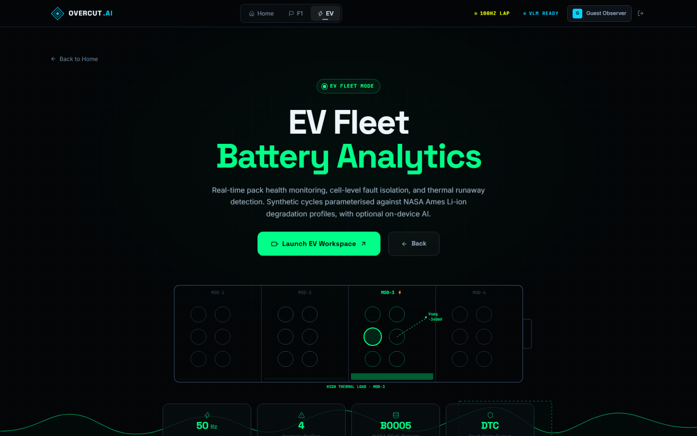
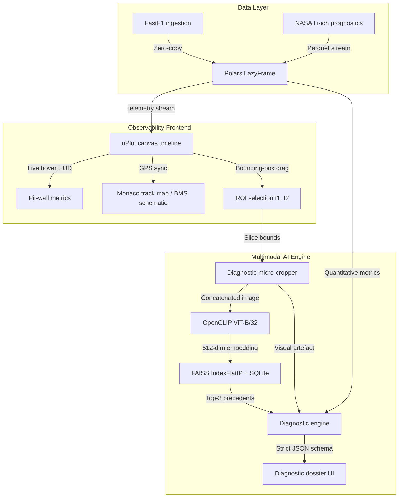

# Overcut.ai

**Generative multimodal observability gateway for high-frequency telemetry.**

Drag a window on a real telemetry trace and get a structured, evidence-cited diagnosis:
fault code, severity, per-channel citations, retrieved historical precedents and
a corrective action — from a 7B QLoRA model running locally in 5.47 GB of VRAM,
or from a labelled deterministic fallback when no GPU is available.

https://github.com/user-attachments/assets/c37fa02d-955a-4fc4-9c57-825b038478da

<sub>20-second launch film — click the poster to play (1920×1080, H.264, 2 MB).</sub>

[](https://fastapi.tiangolo.com)
[](https://pola.rs)
[](https://github.com/facebookresearch/faiss)
[](https://github.com/mlfoundations/open_clip)
[](https://github.com/leeoniya/uPlot)
[](https://openf1.org)
[](https://react.dev)
[](tests/)

---

## What it does

Modern telemetry systems emit millions of samples per minute — a Formula 1 car
at 320 km/h, or an EV pack taking a 150 kW DC fast charge. The anomalies that
matter (tire micro-lockups, aerodynamic balance shifts, cell voltage sags,
thermal gradients) are transients: visible only if you can select the exact
window and compare its shape against engineering precedent.

Overcut.ai is that workflow end to end:

1. **Timeline** — a uPlot canvas over out-of-core Polars frames, with hover HUD
   and bounding-box window selection. Real feeds arrive at ~4 Hz (F1's
   telemetry resolution); the synthetic fallback renders at 100 Hz.
2. **Crop** — the selected window is rendered into a high-contrast, concatenated
   channel image (Matplotlib) that carries waveform *shape*, not just numbers.
3. **Retrieve** — the crop and its metadata are embedded with OpenCLIP
   ViT-B/32 and matched against a FAISS `IndexFlatIP` of baseline incidents
   (cosine similarity on the unit hypersphere, content-hash deduplicated,
   metadata in SQLite).
4. **Diagnose** — a Pydantic-validated report is produced by one of four
   explicitly attributed engines: `LOCAL_VLM` (the optional 7B QLoRA adapter),
   `CLOUD_GEMINI_VLM` (optional), `DETERMINISTIC_HEURISTIC` (always available),
   or `HALLUCINATION_FAILSAFE` (similarity-gated abstention). The UI always shows
   which engine answered.

## Two domains, one pipeline

| Dimension | Domain 1: Motorsport (F1) | Domain 2: Enterprise EV Fleet |
| :--- | :--- | :--- |
| **Telemetry source** | FastF1, 2023 Monaco GP qualifying | NASA Ames Li-ion prognostics (`B0005`/`B0006`) |
| **Target subject** | Max Verstappen (car `#1`) | Unit `EV-B0005`, NMC 811 96S pack |
| **Channels** | Speed (km/h), Throttle (%), Brake (%), Gear | Voltage (V), Current (A), Temperature (°C), SoC (%) |
| **Spatial grounding** | Circuit de Monaco SVG map with live car dot | BMS pack schematic, 4 modules, cell-sag alerts |
| **Precedent classes** | Lockups, snap oversteer, thermal tire degradation | Cell voltage sag (`P0A80`), thermal runaway (`P0A7F`) |
| **Reasoning tier** | Local QLoRA (text) or heuristic | Local QLoRA (text), Gemini (optional), or heuristic |



<sub>The EV fleet workspace: pack topology schematic, live degradation alerts and
the diagnostic dossier launcher.</sub>

### Where the F1 telemetry comes from

2025/2026 sessions are served by [OpenF1](https://openf1.org) — free, no API
key, ~3.7 Hz car telemetry (speed, throttle, brake, gear, RPM) plus GPS and lap
timing. It does not read FastF1's archive, which F1 locked behind authentication
on 2026-10-15; OpenF1 ingests the still-open live-timing feed instead. OpenF1
data is **CC BY-NC-SA 4.0** — attribution is required and commercial use is not
permitted. Sessions already present in `data/raw_cache/` are served from cached
FastF1 laps first; when neither source has data the API returns a deterministic
simulation marked `"simulated": true`.

## Architecture



### Diagnosis contract

Every report validates against [`backend/ai/schema.py`](backend/ai/schema.py):

| Field | Meaning |
| :--- | :--- |
| `dtc_code` | SAE J2012 code for EV faults (`P0A80`, `P0A7F`, …); `null` for motorsport |
| `severity` | `LOW` / `MEDIUM` / `HIGH` / `CRITICAL` / `UNKNOWN` |
| `key_evidence` | Per-channel observations with quantitative deltas |
| `historical_precedents` | Top FAISS matches with similarity scores |
| `recommended_action` | Corrective engineering or strategy action |
| `is_insufficient_data` | Abstention flag when evidence or similarity is below the 0.65 gate |
| `provider` | Which engine produced the report (see above) |

### API

| Method | Path | Purpose |
| :--- | :--- | :--- |
| `GET` | `/api/health` | Liveness plus FAISS vector count and `engine_ready` |
| `GET` | `/api/telemetry/stream` | F1 telemetry stream for a session/event/driver |
| `GET` | `/api/ev/telemetry/stream` | EV cycle stream and pack topology |
| `POST` | `/api/analyze_anomaly` | Crop → retrieve → diagnose a selected window |
| `POST` | `/api/demo` | Deterministic Monaco Q end-to-end slice |
| `GET` | `/api/vlm/status` | Which inference tiers are actually available |

`/api/analyze*` requires `X-API-Key` only when `OVERCUT_API_KEY` is set.

---

## Benchmark

The repository ships a versioned golden set at
[`data/eval/golden_ev_v1.json`](data/eval/golden_ev_v1.json): 200 deterministically
seeded EV battery samples (40 per failure mode, including 40 nominal negatives)
with ground-truth DTC, severity and abstention labels. The adjacent manifest
records the dataset SHA-256, label schema, class distribution and known gaps; the
scorer refuses to run if the hash does not match.

```bash
# Regenerate the golden set (deterministic; same SHA-256 every run)
python scripts/build_golden_set.py

# Dataset statistics only — writes a report with "measured": false
python scripts/evaluate_qlora.py

# Run the 200 samples through the local 7B QLoRA tier (GPU) and score them
python scripts/run_golden_inference.py
python scripts/evaluate_qlora.py --predictions models/ev_qlora_adapter/predictions.jsonl
```

`run_golden_inference.py` uses the production prompt, greedy decoding, one
corrective JSON retry and the labelled heuristic fallback, so the predictions
measure the same path the API serves.

### Measured — before/after (golden set, 200 samples)

Both runs used the same harness, dataset (SHA-256 `39f354b0…a56b41`), batch size
4, greedy decoding and production prompt on an RTX 5060 Laptop GPU (8 GB).
"Before" is the shipped F1-prose adapter; "after" is the EV adapter trained on
`data/qlora_dataset/` (127 train / 23 held-out), 96 steps, 51.8 min, peak 8.35 GB
VRAM, train loss 1.8373 → 0.0001.

| Metric | Before (2026-11-20) | After (2026-11-21) |
| :--- | :--- | :--- |
| Samples evaluated | 200 / 200 | 200 / 200 |
| Provider distribution | `LOCAL_VLM` 200 | `LOCAL_VLM` 200 |
| JSON parse rate | 1.00 | 1.00 |
| Schema compliance | 1.00 | 1.00 |
| Evidence groundedness | 0.975 | 1.00 |
| **DTC accuracy** | **0.00** | **1.00** |
| — P0A1F / P0A7F / P0A80 / P0B3C | 0 / 0 / 0 / 0 | 1.0 / 1.0 / 1.0 / 1.0 |
| Severity accuracy | 0.14 | 1.00 |
| Negative specificity | 0.225 | 1.00 |
| Corrective retries | 0 | 0 |
| Mean latency | 9.31 s | 9.12 s |
| VRAM | 5.47 GB | 5.47 GB |

Reports: `models/ev_qlora_adapter/evaluation_benchmark_before.json` and
`evaluation_benchmark_after.json`; predictions preserved as
`predictions_before.jsonl` / `predictions_after.jsonl`.

**Read the 1.00 carefully.** The before-run shows what an untrained adapter does:
perfect formatting (inherited from the base model) with no EV mapping at all.
The after-run shows the EV adapter reproduces the gold labels exactly on a set
whose crops are hash-disjoint from training but whose labels come from the same
synthetic failure-mode generator — and whose final training loss reached 0.0001.
So 1.00 measures that the model learned this task distribution, not that it
generalises to physical cell measurements; the 23 held-out samples were not used
in this benchmark. The next milestone is an F1 golden set and labels grounded in
real pack data.

Known gaps (recorded in the manifest): there is no F1 golden set yet; labels are
derived from synthetic failure modes rather than physical cell measurements; and
the images come from the same renderer family as the training data.

---

## Quickstart

**Prerequisites:** Python 3.10+, Node.js 18+ (CI runs Python 3.10 and Node 22).

```bash
cp .env.example .env          # every value has a development default
```

`backend/core/config.py` loads `.env` from the repository root; real environment
variables always win. Without a GPU and adapter weights the API reports
`DETERMINISTIC_HEURISTIC` and still produces a complete report.

| Variable | Purpose |
| :--- | :--- |
| `OVERCUT_ENV` | `development` (default) or `production` |
| `OVERCUT_JWT_SECRET` | Session signing key. **Required** in production; dev falls back to an ephemeral secret |
| `OVERCUT_API_KEY` | When set, every `/api/analyze*` call must send `X-API-Key` |
| `OVERCUT_CORS_ORIGINS` | Comma-separated allowed origins (defaults to localhost:3000/5173) |
| `OVERCUT_MONGO_URI` | MongoDB connection string for accounts. When unset, auth endpoints return 503 and only the frontend demo profiles can sign in |
| `OVERCUT_DATA_DIR` | Redirect mutable data (FAISS index, SQLite, parquet, ROI crops) |
| `OVERCUT_MODELS_DIR` | Redirect model adapters |
| `OVERCUT_MAX_CONCURRENT_ANALYSES` | Concurrent heavy analyses before HTTP 429 (default 2) |
| `OVERCUT_OPENF1` | `auto` (default) queries OpenF1 for 2025/2026 telemetry; `off` forces the labelled synthetic path. Timeout via `OVERCUT_OPENF1_TIMEOUT` (seconds) |
| `GEMINI_API_KEY` / `OPENAI_API_KEY` | Optional cloud providers |

### Backend

```bash
# Windows PowerShell
.\venv\Scripts\Activate.ps1

# Reproducible install (universal lock; add --torch-backend cpu on GPU-less hosts)
uv pip sync backend/requirements.lock

# Fallback without uv: top-level pins only
pip install -r backend/requirements.txt

# Seed the FAISS index with baseline incidents
$env:PYTHONPATH="."
python scripts/generate_baseline.py

# Launch the gateway
uvicorn backend.api.main:app --reload --port 8000
```

### Frontend

```bash
cd frontend
npm install
npm run dev
```

Open **http://localhost:5173**. Vite proxies `/api` to `http://localhost:8000`
in development (override with `VITE_API_PROXY`). For split-origin deployments set
`VITE_API_URL` to the backend origin, plus `VITE_API_KEY` if enabled.

If the backend is unreachable the workspace labels the payload `SIMULATED` — it
never presents synthetic data as a live result.

### Tests

```bash
$env:PYTHONPATH="."
venv\Scripts\python.exe -m pytest tests/ -q
```

Current result (2026-11-25): `64 passed, 2 skipped in 34.53s`. Both skips are
opt-in network tests: the FastF1 session download and the live OpenF1 adapter
check (`OVERCUT_OPENF1_LIVE=1`). The suite runs with `OVERCUT_OPENF1=off` so CI
never depends on external telemetry APIs. FAISS/SQLite state is isolated per
test via `tests/conftest.py`.

[`.github/workflows/ci.yml`](.github/workflows/ci.yml) runs the same suite
(including the golden-set manifest, label, disjointness and scorer checks) plus
frontend lint/build on every push and pull request, installing from
`backend/requirements.lock` with CPU-only PyTorch.

---

## Deployment

Frontend and backend are independent: the Vite build is fully static, and the API
is a single container. Full instructions in [`DEPLOY.md`](DEPLOY.md).

- **Frontend:** Vercel Hobby (free), root `frontend`, preset Vite, set
  `VITE_API_URL`.
- **API:** any Docker host with **≥ 2 GB RAM**. Measured on this machine: the
  process reaches **1.29 GB RSS** after CLIP/FAISS load (peak 1.82 GB during
  load, Windows venv with a CUDA build of torch; a Linux CPU-only image is
  smaller, but the CLIP weights alone are ~350 MB). Render's free 512 MB
  instance cannot hold it — and free instances also sleep, while startup was
  measured at **200 s** on a cold CPU container.
- **Costs (verified 2026-11-24):** Hugging Face only hosts *Static* Spaces for
  free — Gradio and Docker Spaces require a paid plan (PRO for personal
  accounts). CPU Basic hardware itself is free hourly and sleeps when idle.
- **CPU-only hosting** serves `DETERMINISTIC_HEURISTIC` with FAISS precedent
  cards empty until `python scripts/generate_baseline.py` seeds the index; the
  dossier still renders without them. The 7B local tier needs a GPU.
- **Moving to AWS:** the same image runs on ECS/Fargate, or on `g5`/`g6` with the
  adapter mounted at `models/adapters/overcut-ev-7b-lora` for real local
  inference. Only `VITE_API_URL` and `OVERCUT_CORS_ORIGINS` change.

---

## Project layout

```text
Overcut.ai/
├── .github/workflows/ci.yml    # Backend tests + golden checks, frontend lint/build
├── backend/
│   ├── ai/                     # Pydantic schema, diagnostic service, prompting
│   ├── api/                    # FastAPI gateway, auth, orchestration
│   ├── core/                   # Runtime configuration
│   ├── data_engine/            # OpenF1/FastF1 & NASA ingestion, ROI cropper, circuit geometry
│   ├── vector_store/           # OpenCLIP ViT-B/32, FAISS IndexFlatIP + SQLite
│   └── requirements.lock       # Universal resolved lock (Python 3.10+)
├── data/
│   ├── eval/                   # Golden set, manifest and crops (200 samples)
│   ├── fine_tuning/            # F1 SFT JSONL
│   ├── qlora_dataset/          # EV SFT set (127 train / 23 held-out) and crops
│   └── ...                     # raw_cache/, db/, generated_roi/ are gitignored
├── deploy/hf-space/            # Dockerfile, start script, Space metadata
├── docs/media/                 # Launch film, poster, workspace screenshot
├── frontend/
│   ├── src/
│   │   ├── components/
│   │   │   ├── TimelineWorkspace.jsx  # uPlot dual-domain canvas
│   │   │   ├── TrackMap.jsx           # Circuit de Monaco SVG + live GPS dot
│   │   │   └── BatteryPackMap.jsx     # 96S NMC 811 pack schematic
│   │   ├── App.jsx             # Shell, diagnostic dossier, domain toggle
│   │   ├── lib/api.js          # Fetch wrapper: base URL, API key, timeouts, abort
│   │   └── index.css           # Editorial dark-mode tokens and styling
│   └── public/                 # Static assets and baseline crop images
├── models/
│   ├── adapters/               # LoRA adapters (configs + logs; weights gitignored)
│   └── ev_qlora_adapter/       # Benchmark reports and prediction metadata
├── scripts/
│   ├── generate_baseline.py    # Seed FAISS with baseline incidents
│   ├── generate_qlora_dataset.py  # Build the 150-sample EV SFT set
│   ├── build_golden_set.py     # Deterministic 200-sample golden eval set
│   ├── train_qlora_ev.py       # QLoRA SFT: product prompt, masked JSON loss, 4-bit NF4
│   ├── run_golden_inference.py # Golden-set inference → predictions JSONL
│   └── evaluate_qlora.py       # Score predictions against the golden set
├── tests/                      # 66 unit, integration and evaluation tests
├── DEPLOY.md
├── .env.example
└── pytest.ini
```

## Limitations

- The golden set is synthetic: labels come from the failure-mode generator, not
  physical cell measurements, and its crops share a renderer family with training
  data. See the caveat under [Benchmark](#benchmark).
- There is no F1 golden set; motorsport quality is demonstrated by retrieval and
  the heuristic/adapter path, not a scored benchmark.
- Real F1 telemetry depends on OpenF1, an unofficial service under
  CC BY-NC-SA 4.0: availability is best-effort, attribution is required and the
  data cannot be used commercially. Responses are cached so demos survive
  outages; the synthetic fallback is always labelled.
- Cloud tiers (`GEMINI_API_KEY`, `OPENAI_API_KEY`) are optional and off by
  default; hosted CPU deployments fall back to `DETERMINISTIC_HEURISTIC`.
- The 7B local tier requires CUDA plus adapter weights under
  `models/adapters/`;
  nothing is bundled, which is why benchmark artefacts are versioned instead.
